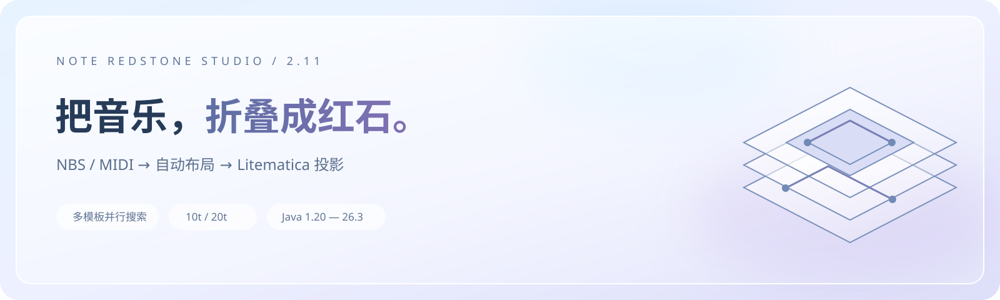
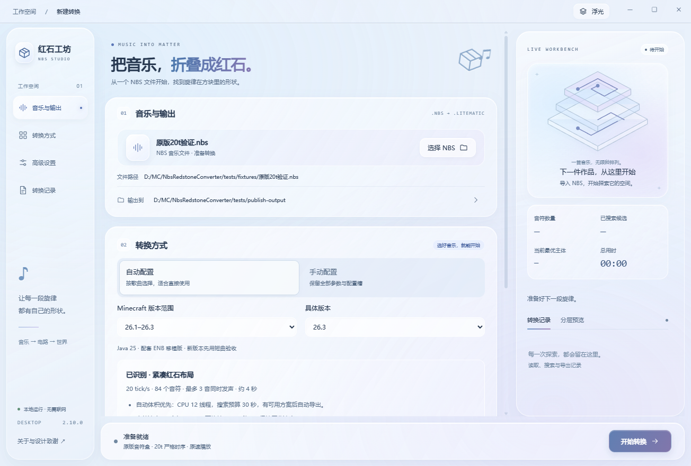
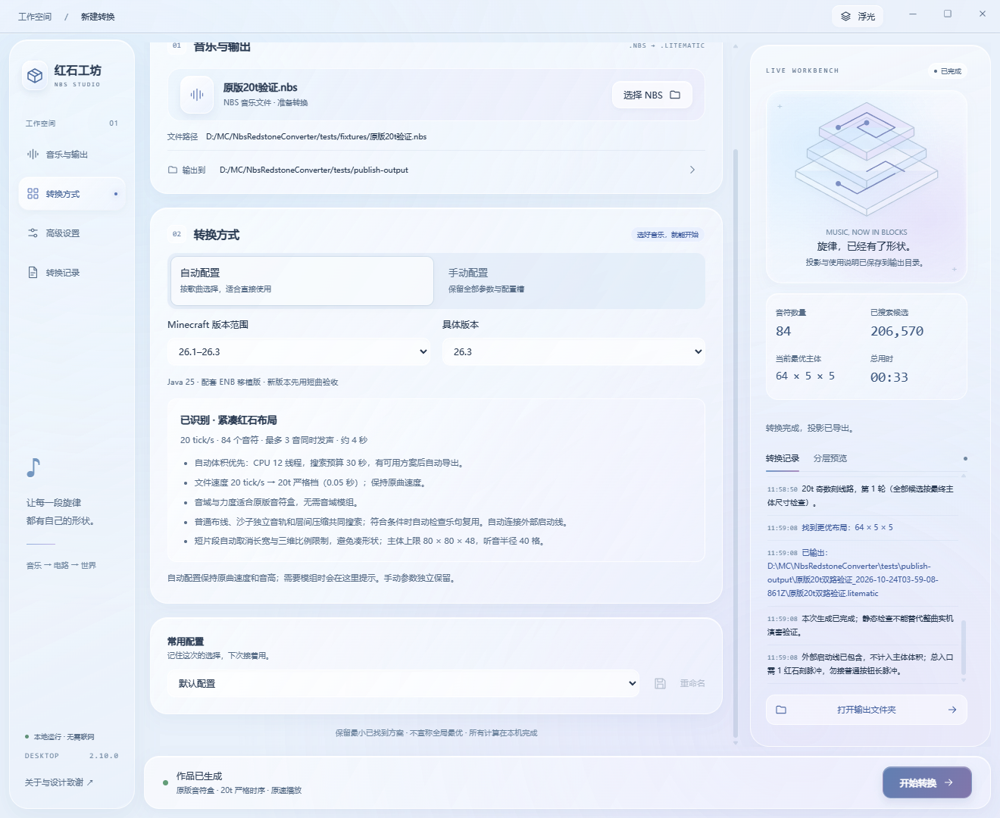
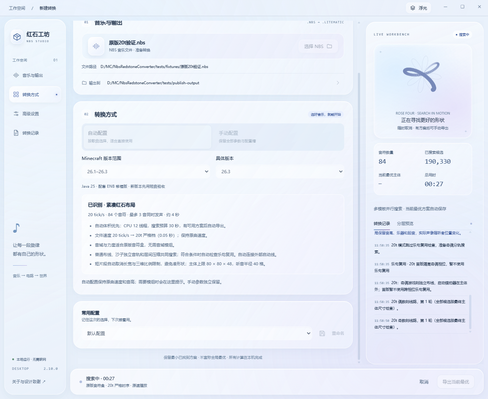
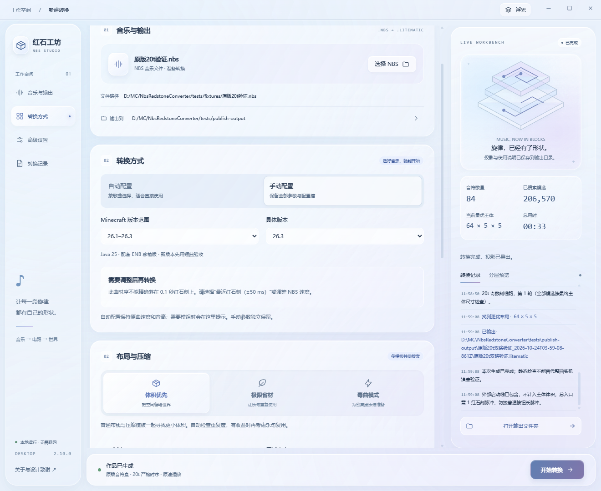

**NBS 红石投影转换器 · Redstone Studio**

从一份 NBS，到一台可以在 Minecraft 中搭建的红石音乐机。

   

**[下载 Windows 便携版](https://github.com/Endframe0/nbs-redstone-studio/releases/latest)** · [开始使用](#开始使用) · [版本兼容](docs/compatibility.md) · [作者致谢](#作者致谢)

## 把音乐变成可以搭建的作品

红石工坊读取 `.nbs` 音乐，分析音高、力度、速度和重复片段，寻找更合适的电路排布，导出 **Litematica 投影、材料清单和启动说明**。在游戏里，真正发声的是红石驱动的音符盒。

初次使用可以交给自动配置：选歌、选游戏版本、开始转换。熟悉之后，再打开手动配置调整尺寸、材料、音域和搜索方式。

截图使用本地测试文件演示操作；发布包不附带这些 NBS。

<table>
<tr><td width="50%"><b>更紧凑的音乐机</b> 普通布线、沙子独立轨与层间压缩共同搜索；根据歌曲选择并行轨道、强充能节点与重复片段复用。</td><td width="50%"><b>保留歌曲的时序</b> 自动识别 2、5、20 tick/s 等节奏。可精确映射的起音保持原速；20t 使用奇偶分相电路。</td></tr>
<tr><td><b>普通歌曲到黑乐谱</b> 体积优先、极限省材、毒曲三种目标。毒曲宽高上限各 100 格，长度按歌曲展开，支持命令方块跟随。</td><td><b>自动上手，手动进阶</b> CPU 多核、可选 NVIDIA GPU、支撑材料、形状限制、5 个命名配置槽，以及上次设置记忆。</td></tr>
</table>

> 搜索结果是预算内找到的较优方案，**不承诺数学意义上的全局最小体积**。主体尺寸不计外部启动电路，但完整投影和材料清单仍包含导出的外部线路。

## 开始使用

### 01 · 下载并打开

在 [Releases](https://github.com/Endframe0/nbs-redstone-studio/releases/latest) 下载 `NBS-Redstone-Studio-2.10.0-Windows-x64.zip`，**完整解压**后运行 `NBS红石投影转换器2.10.0.exe`。不要只取出 EXE。

- Windows 10 / 11，64 位；便携版无需另外安装 Python 或 Node.js。
- 需要 [Microsoft Edge WebView2 Runtime](https://developer.microsoft.com/microsoft-edge/webview2/)。多数 Windows 电脑已有；缺少时安装 Evergreen Runtime。
- 桌面转换在本地运行，不上传你的 NBS。发布包不附带歌曲或演示 NBS，请准备自己的文件。

### 02 · 导入音乐，选择版本

点击 **选择 NBS**，指定输出目录。保持 **自动配置**，先选择 Minecraft 版本范围，再选择实际游玩的具体版本。

自动识别会解释所选的时序和音域方案：

| 你的音乐 | 默认处理 |
| :--- | :--- |
| 2、5 tick/s 等可精确映射的音乐 | 保持原速，使用合适的严格时序 |
| 20 tick/s / 起音需要 0.05 秒精度 | 自动选择 20t 严格档 |
| 超出原版音域，或需要保留音符力度 | 使用配套 ENB；游戏需要安装对应模组 |
| 超过 20,000 音符，或同时发声超过 136 音 | 自动切换毒曲模式 |
| 节奏无法精确落在游戏刻上 | 明确提示；是否近似由你在手动配置决定 |

### 03 · 开始搜索，导出方案

点击 **开始转换**。右侧显示实际候选数量、当前最优主体尺寸和引擎消息；Rose Four 曲线用于表示工作状态，**不是百分比进度条**。

自动模式按预算结束搜索并导出。手动选择「持续优化」时，可在找到可用方案后点击 **导出当前最优**；也可以随时取消。毒曲直接生成，不做最小体积搜索。

### 04 · 进入 Minecraft

转换完成后打开输出文件夹，按照生成的说明加载投影。

| 输出 | 用途 |
| :--- | :--- |
| `.litematic` | 音符盒、电路、底座及选择导出的启动线 |
| `材料清单.csv` | 最终方块数量；需要时另列容器填充物 |
| `转换报告.json` | 尺寸、时序、入口、验证范围等详细信息 |
| `使用说明.txt` | **本次生成结构**的启动方式和注意事项 |

1. 安装匹配游戏版本的 [Litematica](https://github.com/maruohon/litematica) 和 MaLiLib，把投影放到当前实例的 `schematics` 文件夹。
2. 在空旷区域加载、放置投影。创造模式粘贴时需要相应权限；生存搭建需调准音符盒音高和中继器档位，保留音符盒上方空气。
3. **以生成的使用说明为准启动。**普通自动启动线入口通常需要 1 红石刻（2 游戏刻）短脉冲，不能直接接普通按钮的长脉冲。毒曲的按钮控制器按其说明操作。
4. ENB 必须安装对应模组并完整粘贴方块实体 NBT；毒曲的传送需要命令方块权限。演奏时保持电路处于模拟距离内。

## 想进一步调整？

切到 **手动配置**，原有参数仍完整保留。

| 目标 | 适合的设置 |
| :--- | :--- |
| 想尽量小 | 体积优先；调整搜索预算、主体尺寸、长宽差和听音范围 |
| 想尽量省材料 | 极限省材；强制尝试乐句复用并比较完整材料成本，可能占地更大 |
| 同时有数百个音符 | 毒曲；宽高各不超过 100 格，长度不限于一个紧凑包围盒 |
| 想用显卡 | CPU + NVIDIA GPU；加速适用的几何搜索，其余模板仍由 CPU 处理 |
| 经常切换用途 | 默认配置 + 5 个可命名配置槽；主题、字号和上次参数自动记忆 |

GPU 需要兼容的 NVIDIA 显卡与驱动；**不是所有 NVIDIA 型号都保证可用，也不是所有模板都会在 GPU 上运行**。不能使用 GPU 时可选择 CPU 多核。支撑材料可选圆石、石英块、混凝土、铁块、金块等，不会替换决定乐器音色的底座。

默认主题是毛玻璃「浮光」。右上角主题菜单还可切换「纸间」「夜航」，并调整界面字号。

## 游戏版本与音域

**原版投影支持选择 1.20～26.3 的 24 个正式版本。**选版本范围只是筛选，导出仍针对具体版本，不代表同一份文件可以任意降级。

| 游戏版本 | ENB 配套 |
| :--- | :--- |
| 1.20.1、1.21.1 | 官方 ENB + 本项目 NBS 兼容补丁 + 对应 Fabric API |
| 26.1、26.1.1、26.1.2、26.2、26.3 | 本项目对应版本 ENB 移植版 + 对应 Fabric API |
| 其他支持的正式版本 | 可生成原版投影，当前没有配套 ENB 组合 |

配套文件位于下载包的 `配套模组/具体版本`。**只安装与你游戏版本一致的一组**，不要把所有版本混放。Quinn 兼容仍仅开放已适配的 26.1.2；需要自行获取作者的数据包与资源包。

当前已做跨版本导出回读、若干目标版本独立服务端及客户端注入检查；**新增版本尚未逐曲实机试听，静态检查不等于完整演奏验收**。音频扩容、Replay 和光影不是此次跨版本配套的内容。完整范围见 [版本兼容说明](docs/compatibility.md)。

<b>常见问题</b>

**这是播放器吗？** 这是转换器，输出可搭建的电路。普通结构由红石驱动音符盒；毒曲的命令方块负责跟随，不使用播放声音命令代替音符盒。

**为什么选自动配置后需要 ENB？** 原版音符盒不能完整保留扩展音域和逐音力度。自动配置不会悄悄折叠高低音或丢弃力度，因此会提示使用配套 ENB。

**为什么材料清单与主体包围盒不同？** 优化指标排除了外部启动线，但真正搭建仍需要这些方块，清单会计入。Litematica 的完整边界也必须容纳它们。

**大量同刻音符仍有声音缺失？** 布局可容纳不代表客户端能同时混音全部声音。音频通道上限、听音距离、区块加载和服务器性能需要另行处理。

**取消、导出当前最优有什么区别？** 取消停止任务；导出当前最优会结束搜索并保存已经找到的可用方案。尚未找到方案时不能导出。

## 源码与开发

桌面端使用 Python / pywebview + 本地 HTML、CSS、Canvas；电路引擎使用 Node.js，GPU 后端使用 CUDA。ENB 移植和兼容补丁源码在 `mods/`。

见 [开发与构建](docs/development.md)。远程 Web 服务没有包含在这个桌面发行包中。此仓库不含个人配置、访问令牌、游戏存档或歌曲库。

## 作者致谢

这个项目建立在许多作者公开的工具、结构研究和设计经验之上。感谢他们让红石音乐更容易制作，也更容易理解。

| 作者 / 项目 | 在本项目中的作用 |
| :--- | :--- |
| **Atemukesu · [Extended Note Block](https://github.com/atemukesu/ExtendedNoteBlock)** | ENB 音域扩展的原始模组；本项目提供高版本移植与 NBS 力度、原版音色兼容。保留上游 MIT 许可与作者署名。 |
| **kemiamu、omninbs 与 [nbs-fractal 贡献者](https://github.com/omninbs/nbs-fractal/blob/main/CONTRIBUTORS.md)** | [u-u.life 生成器](https://u-u.life/nbs/#torrent)、Compact 节点、错位排列和重复结构研究，为压缩模板提供重要参考。上游为 AGPL-3.0-or-later。 |
| **0x4e49434f4c45 · [Note Block Assistant](https://github.com/0x4e49434f4c45/noteblock-assistant)** | 三轨互嵌、紧凑布置与接近方形的听音布局参考。 |
| **Quinn-Codes · [Quinn's Better Noteblocks](https://github.com/Quinn-Codes/QuinnsBetterNoteblocks)** | 可选数据包音域兼容方案；其资源包与数据包不随本项目重新分发。 |
| **Emil Kowalski · [Design Engineering Skills](https://github.com/emilkowalski/skills)** | 界面层次、交互反馈与动效节奏的设计参考。 |
| **Paidax01 · [Math Curve Loaders / Rose Four](https://paidax01.github.io/math-curve-loaders/)** | 搜索与加载的数学曲线动画参考；本项目使用独立 Canvas 实现。 |
| **maruohon、sakura-ryoko 与 Litematica / MaLiLib 贡献者** | 投影生态与格式兼容参考；[上游项目](https://github.com/maruohon/litematica) · [维护分支](https://github.com/sakura-ryoko/litematica)。 |
| **Open Note Block Studio 社区** | NBS 音乐格式与制作生态；[项目地址](https://github.com/OpenNBS/OpenNoteBlockStudio)。 |
| **Etho、Xisuma 与红石创作者社区** | 漏斗计时、可平铺模块、音乐机存储与发声分离等结构研究参考。 |
| **pywebview、Node.js、Python、Fabric、exp4j 等贡献者** | 桌面窗口、运行时、模组加载与表达式计算等基础组件。 |

更多来源和许可证见 [第三方组件与致谢](THIRD_PARTY_NOTICES.md)。本项目的功能说明不代表上述作者为本项目背书；音乐作品的权利属于各自作者。

---

**本软件由 GPT6Astra 制作。**

